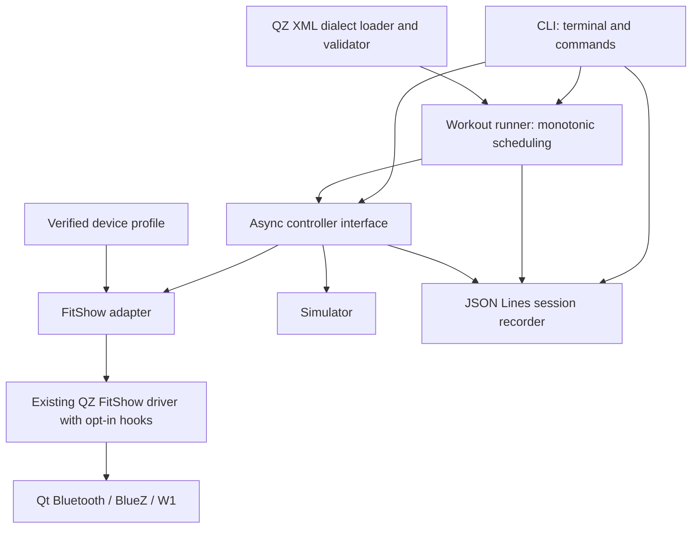

# Architecture recommendation

Baseline and evidence conventions: [repository assessment](01-repository-analysis.md). All interfaces, paths and behaviors below are **recommendations**, unless explicitly cited as existing source.

## Decision: Option B, with bounded driver changes

Create a separate `treadmill` executable, initially under `tools/treadmill/`, using C++17, qmake and `QCoreApplication`. Reuse the existing FitShow implementation through a narrow asynchronous adapter. Initially allow linking the existing static QZ archive to prove reuse; measure its dependency closure before trimming. This means a small runtime application with a potentially large build dependency footprint.

The adapter alone cannot fix private FIFO ordering, automatic initialization/reconnect or private capability fields. Before real motor use, add explicit opt-in driver policy and observable events/cancellation, preserving existing QZ defaults. Do not interpret this plan as authorization to implement those changes during planning. First implement a diagnostic target that directly uses Qt Bluetooth and never constructs the FitShow driver. It reuses the transport library without running its initialization.

| Approach | Complexity / reuse | Dependencies / testing | Maintenance / extraction / QZ risk |
|---|---|---|---|
| A: extend QZ headless and scheduler | CLI loading is missing; scheduler reused but safety retrofit is substantial | Full QZ; coupled tests and settings | Small new target work, broad behavioral surface; harder extraction, higher existing-app risk |
| B: separate CLI and driver adapter | Moderate; existing FitShow packets/GATT retained, focused scheduler new | Core-only simulation possible; driver initially broad link closure | New files isolated; narrow driver patches reviewable; good later extraction, moderate risk |
| C: extract internal library first | Highest initial refactor; shared code reuse strongest | Eventually smallest footprint; upfront dependency surgery/testing | Best eventual boundary, largest initial upstream merge and regression burden |

B meets the proof-of-concept scope without claiming the present driver is already safe. If the build spike shows wholesale `homeform`/factory extraction is needed, record the link evidence and reassess a small C subset; do not silently rewrite FitShow or expand to a general SDK.

## Boundaries and dependency direction

Driver parses raw protocol facts. Adapter validates capabilities, performs device calibration, owns command lifecycles and motor authorization. Runner supplies paired targets, stage timing and warnings. CLI handles user intent and presentation. Persistence observes events and must not issue controls. Simulation uses the same controller contract; it must never instantiate a BLE discovery agent.

Data flow: XML → generic stages → validated profile mapping → paired physical target → command record → driver queue → transport completion → protocol response → valid status sample → settled/rejected/timed-out result. Display both requested and reported values, including raw versus calibrated incline when diagnostic mode is enabled. A reported target is not proof of measured belt motion.

## Proposed asynchronous contract

Use a QObject-derived interface with slots for connection, capability query, start, stop and paired target requests, each carrying a locally generated command ID/session generation. Return submission acceptance only; signals deliver connection changes, capability snapshots, valid telemetry samples, command progress and faults. Simulator and real controller implement identical signal semantics. No method blocks until movement completes.

Public data eventually includes capabilities with evidence/validity, speed km/h, incline percent, telemetry timestamp and raw status, connection/state enums, paired targets, command outcome, and structured errors. Capabilities distinguish advertised, protocol-reported and physically validated values. Unknown is explicit, never numeric zero by default. Profile binds calibrated units/mapping and verified stop behavior to device/model/firmware evidence.

Internal details: UUID mappings, initialization packets, byte scaling, checksum/parser, FIFO storage, retry correlation, QZ metrics/settings adaptation and transport callbacks. CLI and workout file never see QZ request sentinels or raw incline codes. Avoid a plugin framework or thread pool in v0.1.

## Required driver integration work

1. Add opt-in policy controlling initialization writes, motor permission, reconnect, optional virtual-device creation and FTMS profile mutation. Existing QZ constructor behavior remains the compatibility default. Driver `noConsole` is currently unused; it is not such a policy.
2. Expose validated capability and status snapshots/events, raw motor speed/incline, per-field freshness and malformed-frame errors. Timestamp only complete valid relevant reports, not `packetReceived`.
3. Provide paired target submission after full safety validation, bypassing or explicitly neutralizing QZ gains, sensor corrections, power following and difficulty transformations. Final wire validation occurs after conversion; reject out-of-range values rather than silently clamp or wrap.
4. Give stop its own highest-priority path: atomically purge unsent motor entries and request fields, invalidate generation, suppress automatic targets/start and cancel retries. A callback carrying an old generation cannot submit anything.
5. Replace the nested write event loop with asynchronous completion/deadlines for the opt-in path. Serialize at most one ordinary protocol command; coalesce unsent target pairs. Do not parse debug strings as API events.
6. Suppress automatic reconnect/reinitialization writes in CLI policy. A later explicit reconnect creates a new generation and returns to preflight.

Protocol lacks a verified unique sequence token. Local IDs cannot solve delayed matching responses on the wire. Treat matching command/subtype as weak acknowledgement only, never permission to skip telemetry observation. Establish device-specific late-response handling during M1.

## Event loop and CLI

One Qt thread owns state, BLE objects, timers and input. QTimer wakes the runner; `QElapsedTimer` or an injected steady clock supplies elapsed time. No nested `exec`, blocking stdin read, synchronous sleep or network authentication. Use QSocketNotifier on nonblocking stdin; optional termios for single-key controls, restored on every normal exit. Signal handler only writes to a self-pipe; Qt drains it and initiates stop. SIGINT/SIGTERM/SIGHUP enter the same bounded shutdown path. SIGKILL/crashes remain outside software guarantees.

Commands: `scan`, `info --device <id>`, `status --device <id>`, `workout list`, `workout run <id-or-path> --simulate`, and hardware `workout run <id-or-path> --device <id> --profile <path>`. Refuse ambiguous devices. `scan/info` default to strict read-only discovery; later protocol info queries require a separately enabled nonmotor diagnostic mode. Status reports unknown when notifications are unavailable read-only. Before real run show device, calibrated limits, resolved targets and duration, then require typed confirmation on an interactive terminal. No implicit confirmation from a config file or closed stdin; noninteractive automatic hardware starts are excluded in v0.1.

During run render elapsed/remaining, current and next stage, actual/report age, pending target, transition countdown and fault. P/R appear only if physical pause/resume is validated; S aborts, Q stops then exits. Reductions take priority and latch an upper intensity ceiling through the rest of the workout; they cannot be overridden by later stages. Skip is deferred from minimum scope. EOF or lost terminal while controlling hardware initiates abort, not indefinite unattended operation. Simulation can support noninteractive execution.

## Configuration and persistence

Use a separate QSettings namespace/config path selected with QStandardPaths. No inherited QZ profile, cloud credentials, user body measurements or background services. Generic configuration: workout directories/selection, explicit speed unit, notification offsets, log directory/verbosity and optional lower safety ceilings. Device profile: identifier/firmware evidence, selected UUID pair, speed scaling/min/max/resolution, discrete raw incline→measured-percent table, supported start/stop/pause, verification timestamps and response deadlines. Keep device calibration outside generic FitShow code. Limits may only reduce the validated operating envelope.

JSON Lines session records carry UTC timestamp, monotonic offset, session/generation/command IDs, event type, stage, requested pair, reported pair and freshness, connection events, acknowledgement strength, deadlines/timeouts, user action and final reason. Log raw frames only in an explicit diagnostic stream; avoid personal info and redact device addresses in exported reports. Bounded buffering/file rotation prevents logging from starving BLE. If mandatory session recording fails before start, refuse run; if it fails during run, warn and stop in a controlled manner. stderr faults remain visible with debug disabled.

## Future extraction

Once adapter, simulator and runner contracts are stable, move the controller/data types and minimum FitShow dependencies into an internal qmake library target. Separate XML/runner into a second reusable module if needed. CLI depends on those modules, not vice versa. Retain asynchronous ownership rules and applicable GPL terms. Public versioning/install headers and an SDK are M5 decisions after evidence; no synchronous convenience API promising physical completion.
