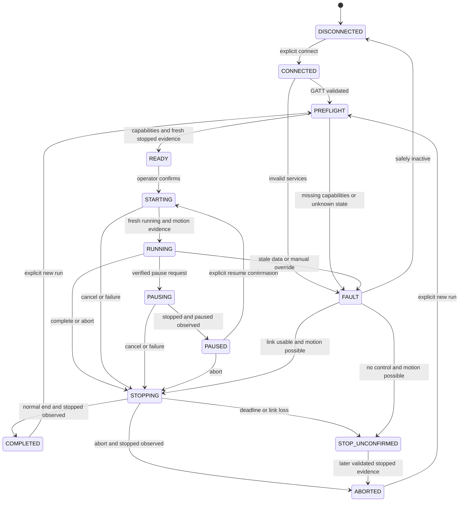

# Safety and asynchronous state machine

All behavior here is a **recommendation** for implementation. Existing driver gaps are confirmed in [01](01-repository-analysis.md); physical behavior remains unknown. This proof of concept has no safety certification. The physical emergency-stop mechanism is primary.

## States

Any link loss revokes authorization, increments generation and clears automation. When motion was possible, enter STOP_UNCONFIRMED, with connection independently marked disconnected. Before motion, return DISCONNECTED with reason. State enums do not replace independent connection/freshness fields. STOP_UNCONFIRMED may reconnect for explicit observation/stop recovery, never acceleration or resume. Late stopped evidence can update outcome but cannot restart a workout.

| State | Entry / telemetry requirement | Allowed user commands / motor permission | Timeout / exit / error |
|---|---|---|---|
| DISCONNECTED | No usable BLE connection; old samples invalid | Scan/connect/info/quit; no motors | Bounded connect failure stays disconnected; success → CONNECTED |
| CONNECTED | GATT connection, not capability readiness | Inspect/disconnect/quit; no motors | Discovery deadline → FAULT; valid layout → PREFLIGHT |
| PREFLIGHT | Fresh validated identity/capabilities/raw status | Review/abort/quit; nonmotor queries only | Missing/contradictory limits or moving/unknown initial state → FAULT; fresh stopped evidence → READY |
| READY | Profile matched, envelope validated, stopped samples fresh | Confirm start/cancel/quit; no motors until confirmation | Sample expiry returns PREFLIGHT; confirmation → STARTING |
| STARTING | One confirmed start/resume; generation current | Stop/quit; approved initial pair/start only | Running/motion evidence within startup deadline → RUNNING; countdown overruns/error → STOPPING or STOP_UNCONFIRMED |
| RUNNING | Fresh relevant reports and valid envelope | Stop/quit/reduce; pause only verified; stage paired targets permitted | Settling timeout/stale data/manual override → FAULT; end/abort → STOPPING |
| PAUSING | Verified pause supported; automation frozen | Stop/quit; pause only, no queued targets | Paused status plus stopped evidence → PAUSED; timeout → STOPPING |
| PAUSED | Fresh paused/stopped evidence; elapsed frozen | Stop/quit/reduce/confirm resume; no targets/start until confirmation | Freshness loss → FAULT; resume → STARTING with retained elapsed time and fresh target |
| STOPPING | All start/target work invalidated; end reason latched | Stop/quit; stop only | Fresh adequate stop evidence → COMPLETED/ABORTED; deadline/link loss → STOP_UNCONFIRMED |
| COMPLETED | Normal completion plus confirmed stop | Inspect/new run/quit; no motors | Explicit new run → PREFLIGHT; unexpected movement → FAULT |
| ABORTED | User/fault termination plus confirmed stop | Inspect/new run/quit; no motors | Explicit new run → PREFLIGHT; no automatic recovery |
| FAULT | Structured cause, automation revoked | Inspect/stop/quit/reconnect; stop only if possible | If motion possible → STOPPING or STOP_UNCONFIRMED; safely inactive → DISCONNECTED/PREFLIGHT after explicit retry |
| STOP_UNCONFIRMED | Motion may persist; stop cannot be established | Prominent physical-stop instruction; explicit reconnect/stop/inspect/quit; stop only | Never auto-complete or auto-resume; later stop evidence → ABORTED; retain warning on exit |

## Command lifecycle and race prevention

Track created → validated → queued → submitted → transport-completed (if provided) → weak protocol acknowledgement → target observed → settled, rejected or timed out. Observation may arrive before acknowledgement; record both independently. Missing ack must not cause blind retry if telemetry already demonstrates the result. An ack alone never completes movement. Each command records generation, local ID, exact quantized pair, submit/deadline monotonic times and evidence. Firmware has no confirmed unique transaction ID; local IDs annotate local work only.

One Qt thread owns state. On abort: first latch motor prohibition and increment generation, then cancel runner timers/notifications, clear pending paired targets/start flags and driver motor FIFO/retries, then issue priority stop if usable. Check prohibition/generation immediately before every write and from every asynchronous callback. Ignore old callbacks except diagnostic recording. Stop overtakes ordinary commands even if the prior write callback is pending; already transmitted packets cannot be recalled. Never queue a new start behind stop. Duplicate stop requests coalesce, and no target follows until a completely new preflight and confirmation.

The current driver processes speed/incline/start before stop and appends stop to FIFO (`fitshowtreadmill.cpp:190`–`:275`); adapter-only cancellation cannot enforce this policy. Driver queue hooks and asynchronous write handling are mandatory gates for real workouts.

## Observation, deadlines and retries

Stop requested, transport sent, protocol acknowledged, reported stopped and physically supported stopped evidence are separate UI/log statuses. QZ currently forces speed zero for nonrunning statuses, so stop validation must retain raw report values. M1 must determine whether raw speed is actual measurement or a setpoint and whether stopped status precedes belt deceleration. If zero is only a target, autonomous stop verification is unsupported; display STOP_UNCONFIRMED until additional trustworthy observation/operator confirmation. Identify manual physical confirmation as manual evidence, never sensor proof.

Provisional simulator/development defaults, **not verified W1 limits**: relevant telemetry stale after 2 seconds; transport deadline 1 second; protocol ack deadline 2 seconds; start including countdown 15 seconds; speed settling 10 seconds; incline settling 30 seconds; stop 10 seconds. Before hardware runs replace with measured latency envelopes and conservative ceilings. Preflight requires multiple consistent stopped samples (initial recommendation three consecutive valid reports). Settling requires repeated samples within verified resolution/tolerance and matching status; ack/status/RSC alone must not refresh all fields. Deadline enforcement uses monotonic time.

No automatic retry of start/resume or intensity-increasing targets in v0.1. On ambiguous delivery, observe, then fault/stop if unresolved. Nonmotor queries can retry twice at bounded intervals. Stop may retry only after W1 stop idempotence is validated, with a small bounded budget (initial proposal two retries); invalidates all prior target retries. Retry exhaustion retains STOP_UNCONFIRMED, never declares success. Protocol late-response ambiguity cannot be removed without firmware support; serialize commands and use telemetry as independent evidence.

## Manual override and reconnection

Distinguish expected settling from unexpected change using pending target, tested delay, raw status and error/safety reports. Unexplained physical-console speed/grade changes revoke automation; cancel future increases and warn. Do not fight the console or adopt the change as a new workout target automatically. If still moving, attempt stop while connected. The optional CLI reduction is an explicit authorized action and latches a lower ceiling for all later stages. A physical stop/safety event always terminates the run.

No automatic reconnect under CLI driver policy. An explicit reconnect starts a new generation, rediscovers services/capabilities and clears old targets. A previously moving session remains terminated; stopped state must be re-established. Application restart reads configuration, not a resumable motor command. Device resets/firmware changes invalidate profile evidence. Multiple controllers are operationally excluded; software cannot prove exclusivity until hardware behavior is known.

## Hazard and failure analysis

| Hazard / trigger | Detection | Mitigation and remaining limit |
|---|---|---|
| Wrong device selected | Ambiguous scan, identity/profile mismatch | Explicit identity, full preflight; names/addresses alone may be unstable |
| Wrong units/byte overflow | Profile mismatch, conversion bounds | Validated scale, finite values and final-wire checks; reject unknown units |
| Incline level treated as percent | Uncalibrated mapping | Physical table; prohibit inferred linear mapping |
| Stale paired value restores higher intensity | Pair/generation mismatch | Atomic paired commands, latest target only, manual ceiling |
| Stop delayed behind ramp queue | Stop request while target pending | Driver priority purge; already delivered command may still act |
| ACK mistaken for movement | ACK without valid status evidence | Separate lifecycle stages; hardware may report only targets |
| Stale speed hidden by unrelated packets | Valid per-field sample ages | Freshness watchdog, automation revoke; no BLE stop guarantee after loss |
| Delayed response completes wrong command | Matching subtype but old context | Weak ACK classification, serialization, target observation; no unique wire ID |
| Start repeated after timeout | Retry/callback after abort | No start retries; generation gate at write boundary |
| Link loss/reconnection restarts | Connection event | Clear queue/authorization, explicit reconnect/preflight; cannot stop offline |
| Physical override fought by scheduler | Unexpected stable sample/status | Suspend and stop; detection depends on observable hardware behavior |
| Parser accepts short/corrupt data | Invalid checksum or message length | Strict per-message lengths; malformed reports never count as fresh |
| Wall-clock jump/OS suspend causes burst | Monotonic gap/resume detection | Abort on excessive gap, no catch-up writes |
| Terminal lost/process shutdown | EOF/self-pipe signal | Bounded stop procedure and warning; SIGKILL/crash cannot guarantee stop |
| Logging/event-loop blockage | Buffer pressure/control latency | Bounded logs/no nested waits; operational delays still possible |
| Safety key removed/error status | Validated safety/error report | Terminate automation, no reset/restart command; physical controls primary |

## Shutdown and guarantees

Normal quit, stdin EOF, SIGINT/SIGTERM/SIGHUP enter abort/STOPPING while Qt is still running. Keep transport alive until observed stop or bounded deadline, flush outcome, restore terminal and exit. Second quit/signal cannot bypass warning silently; if forced exit is offered, show that stop is unconfirmed. Suggested exit statuses: zero only for successful simulation/completed verified session, nonzero for aborted/faulted/unconfirmed sessions, with distinct structured reasons.

Software cannot guarantee stop after BLE failure, power/OS failure, process crash/SIGKILL, defective motor firmware or a physical mechanism failure. It cannot prove physical speed/incline from a setpoint report, enforce exclusive ownership without hardware support, recall packets already delivered, or detect every manual intervention without telemetry. Communicate these limits at preflight and whenever stop is unconfirmed.
