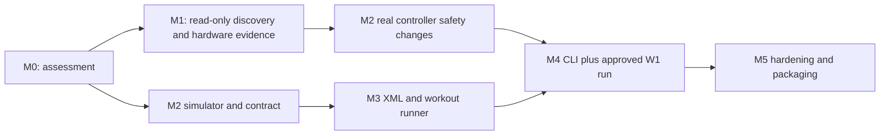

# Incremental implementation roadmap

Planning baseline: `8b2e98ccc21cf28d3b946192094f4fb8af40d943`. This is an ordered **recommendation**, not implemented functionality. Complexity uses S (local bounded task), M (cross-component behavior), L (driver/state integration). Hardware access and protocol ambiguity dominate elapsed time, so no calendar estimate is credible yet.

## Dependencies and order

Hardware research and simulator development can proceed independently after M0. Real control depends on hardware evidence. CLI skeleton needed for diagnostics precedes full M4 interaction. Each task below is a reviewable change with its own acceptance evidence; no production changes are part of this planning deliverable.

## M0 — Assessment (this deliverable)

Deliverables: eight planning documents covering source analysis, Option B decision, W1 validation matrix, XML recommendation, example workout, safety/state machine, testing and questions.

Done when: source references and exact commit are recorded; confirmed/inferred/unknown claims are distinct; no motor actions or production edits occurred. Remaining risk: static inspection does not prove successful build, runtime isolation or hardware behavior.

## M1 — Linux diagnostics and hardware compatibility

| Task | Scope / size | Dependency | Acceptance / deliverable |
|---|---|---|---|
| 1.1 | Add separate qmake C++17/Core/Bluetooth diagnostic target with `treadmill scan` (S) | M0 | Explicit scan timeout, stable report, no driver construction or writes; document build |
| 1.2 | Add `info --device` read-only GATT/characteristic metadata and readable Device Information (M) | 1.1 | Trace proves no CCCD/characteristic writes; unavailable data says unknown |
| 1.3 | Record exact W1 identity, variant, firmware, GATT and Linux permissions (S + hardware) | 1.2, physical access | Reviewed report; choose mapping without name guessing; explain adapter/security failures |
| 1.4 | Build/link spike for existing driver and transitive dependencies in isolated target (M) | M0 | Record actual object/module closure and UI singleton references; decide whether bounded isolation is feasible |
| 1.5 | Define reviewed nonmotor diagnostic initialization/subscription/query mode (M) | 1.3 | Explicit allowlist, no start/target/user reset replay; operator-approved trace |
| 1.6 | Observe console-driven units, limits, incline mapping, status/ACK semantics (M + hardware) | 1.5 | Validated device-profile data or classified blockers, including reported-vs-measured distinction |
| 1.7 | Separately confirmed bounded start/stop and conservative paired-control validation (L + hardware) | 1.6, opt-in driver safeguards from 2.4–2.7 | Physical/telemetry evidence, response envelopes, stop idempotence; optional pause remains gated |

First coding task is **1.1**. It is useful without assumptions about W1 packets and cannot trigger driver initialization. No motor API in that change. Tests for timeout/error/report formatting use a fake discovery boundary; manual scan is read-only. Do not start by invoking existing QZ `-no-gui -train` against W1.

1.7 uses a manual guarded diagnostic control path over the reused driver, after the opt-in safety hooks from 2.4–2.7 pass transport tests. It requires valid capabilities, confirmation and stop cancellation. This creates an explicit interleave: M1 read-only/nonmotor evidence → M2 driver safeguards → M1 bounded motor validation → M2 adapter acceptance. It does not require a completed workout engine or a second FitShow implementation.

M1 done: Linux read-only tool reproducible; necessary control, units/mapping and observable states validated, or unsupported behavior explicitly identified. If any mandatory workout operation is blocked, continue simulator work and keep hardware execution disabled. Main risks: exact W1 variant, private initialization, missing feedback and inability to establish physical stop.

## M2 — Controller, simulator and driver hooks

| Task | Scope / size | Dependency | Acceptance / deliverable |
|---|---|---|---|
| 2.1 | Define QObject controller/data contract and injected clock (S) | M0 | Units/unknown values and asynchronous result semantics explicit |
| 2.2 | Implement deterministic simulator plus connection/start/stop/paired targets (M) | 2.1 | Independent contract tests; zero BLE calls |
| 2.3 | Add simulator delay/rejection/stale-data/manual-override/stop-failure scenarios (M) | 2.2 | Each fault has expected state and recorded event sequence |
| 2.4 | Add opt-in FitShow policy to suppress motor initialization, virtual devices, FTMS mutation and reconnect (M) | 1.4 | QZ default behavior preserved; restricted path sends only permitted writes |
| 2.5 | Tighten per-message length checks and expose raw status/capability/freshness events (M) | 1.6, 2.4 | Boundary fixtures/sanitizer evidence; malformed frames never refresh state |
| 2.6 | Add paired target path and wire-level envelope validation (M) | 1.6, 2.5 | No hidden QZ gain/difficulty/sensor correction; mapped pair matches expected bytes |
| 2.7 | Implement async command tracking, queue purge, priority stop and generation guards (L) | 2.4–2.6 | Abort/write/ACK races covered; no old-generation motor writes |
| 2.8 | Bind adapter state/authorization/deadlines to driver and validated profile (L) | 1.7, 2.7 | Start/stop basic operations independently testable, truthful timeout outcomes |

M2 done: real and simulated operations share one asynchronous interface; capability gates, stop priority, stale detection and reconnect prohibition pass. Main risk: private driver internals and delayed same-subtype responses; cannot solve wire correlation by local IDs alone. Revisit bounded Option C only if 1.4 demonstrates extensive linkage/refactor pressure.

## M3 — Generic workout runner

1. Extract/reuse relevant QZ XML parsing semantics behind a standalone model (M; depends 2.1). Fixtures prove fixed rows, repeats, text events and speed ramps; no integration-heavy scheduler construction.
2. Add strict validation, explicit units, metadata and incline-ramp extensions (M). Test malformed values, bounded expansion, unsupported controls and exact endpoints. Document legacy compatibility limitations.
3. Implement monotonic logical-stage runner and coalesced paired target generation (M; depends 2.2). Test lags/deadlines and avoid catch-up bursts.
4. Add 30/10/transition notifications, warm-up/cooldown/end stop, manual ceilings and state machine (M). Test abort during each pending operation and duplicate events.
5. Supply complete external 1,200-second example XML and an unrelated second short workout (S). Validate hardware adaptation preview in simulation; no code changes needed to add a third plan.

M3 done: full example and different second workout pass deterministic simulation including stop; logical ramps/events remain intact and physical delays are visible. Risk: legacy ramp behavior and ambiguous grade mapping; reject unsupported targets before starting.

## M4 — CLI integration and approved full workout

1. Wire `workout list/run`, plan paths, separate config namespace and explicit simulator backend (S; depends M3).
2. Add preflight summary, calibrated-target preview, fresh state checks and typed hardware confirmation (M; depends M2).
3. Render stage/elapsed/next/report age/pending pair/fault, with event-driven stdin and terminal restoration (M).
4. Route stop/quit/EOF/signals through bounded STOPPING; enable pause/resume only from validated profile (M).
5. Record JSON Lines lifecycle/results plus separate diagnostic traces, bounded output and unconditional fault warnings (M).
6. Run pseudoterminal/CLI simulator integration, then manually approved conservative W1 session after all hardware gates (L + hardware).

M4 done: CLI completes simulation and, if evidence supports required operations, W1 example; abort/stop outcomes are explicit. No headless GUI dependency at runtime, no cloud/sensor subsystems started. Risk: console conflicts, signal handling and misleading telemetry; unsupported physical acceptance is reported as a blocker, not replaced by a simulation claim.

## M5 — Hardening, reproducibility and library path

1. Complete driver/runner failure-injection coverage and QZ regressions (M).
2. Pin Linux/Qt/submodule versions, document actual dependencies, permissions and shadow build (S).
3. Add CI jobs for simulator/protocol and QZ regression; never hardware motor tests (M).
4. Inventory runtime binaries/modules and notices/source obligations; package binary, plans, profiles/schema docs and source recipe (M).
5. Repeat supervised hardware acceptance on recorded firmware; finalize deadlines and supported operations (L + hardware).
6. Stabilize internal controller interface; document minimum extraction target and headers with measured dependency closure (M). Only then extract a library if justified; no general SDK is required for v0.1.

M5 done: clean checkout builds reproducibly; complete fault matrix and documented W1 evidence; installation/runtime licenses accounted for; reusable controller boundary independent of CLI. Risks: old Qt dependencies, third-party closure, hardware firmware changes and upstream merges.

## Risk register and implementation discipline

| Priority | Risk | Owner task / response |
|---|---|---|
| Critical | FitShow-app branding does not establish W1 motor compatibility | 1.3–1.7; hardware gate |
| Critical | Stop/motion feedback may be setpoints only | 1.6–1.7; disable autonomous verification if unsupported |
| Critical | Old queued/retried command acts after abort | 2.7; write-boundary generation checks |
| High | Unknown incline levels and speed units | 1.6/2.6; calibrated profile and finite wire bounds |
| High | Driver isolation pulls whole QZ/UI | 1.4/2.4; measure and reassess bounded extraction |
| High | Same-subtype late ACK ambiguity | 1.6/2.7; weak ACK semantics and independent observation |
| Medium | XML ramp duration/endpoints/events differ from intent | M3; legacy fixtures and explicit CLI rules |
| Medium | Upstream regression/merge conflict | M2/M5; isolated new target and small opt-in patches |
| Medium | Qt/BlueZ permissions and build drift | 1.1/M5; pin versions and verify backend |

Every future change should cite its task, scope and acceptance evidence. Request clarification if new evidence changes requirements; do not infer an alternate manufacturer, protocol or training goal. If adding QZ discovery patterns later, check all name conflicts/order and add detection tests. If any persistent QML settings are added later, update catalog/count/property ordering as required by AGENTS.md; the CLI plan itself needs no QML changes. Do not bump application versions or create implementation commits during planning.
